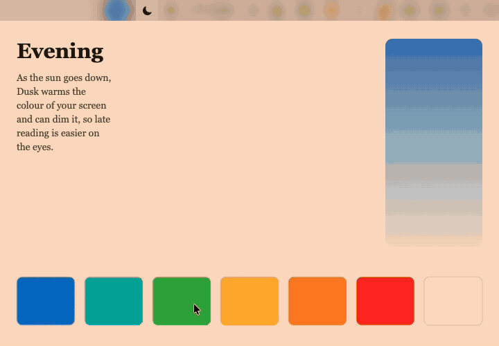

# Dusk

A tiny macOS menu-bar app that warms (and optionally dims) your screen after sunset, then clears it again at sunrise.



([MP4 version](docs/menu-demo.mp4))

## Why

Bright, blue-white screens late in the evening are hard on the eyes and can keep you awake. Dusk is a minimal take on the idea behind [f.lux](https://justgetflux.com):

- **It follows the real sun.** Dusk works out sunset and sunrise for your location, entirely on your Mac with no network. It fades the colour over about an hour of twilight, so you hardly notice the change.
- **It's adjustable.** Night colour runs from 6500K (neutral) down to 1900K (candlelight) in 10K steps, and night brightness from 100% down to 10%. While you drag either slider, Dusk previews the full night look, even in daytime.
- **It takes a break when you need one.** *Disable for an hour* or *Disable until sunrise* for colour-sensitive work, then *Resume*.
- **It's light.** One small native app, with no dependencies and no background services.

## Download

Grab `Dusk.zip` from the [latest release](https://github.com/boyanangelov/dusk/releases/latest), unzip it and move `Dusk.app` to Applications.

The app isn't signed with an Apple Developer ID, so macOS blocks it the first time. To open it anyway, either:
- right-click the app and choose **Open**, or
- go to **System Settings ▸ Privacy & Security** and click **Open Anyway**.

You can also clear the quarantine flag from a terminal:

```sh
xattr -dr com.apple.quarantine /Applications/Dusk.app
```

On first launch Dusk asks for your location so it knows when the sun sets. If you say no, it estimates your location from your time zone.

## Requirements

- An Apple Silicon Mac (M1 or later) running macOS 11 (Big Sur) or later
- To build from source: the Xcode Command Line Tools (`xcode-select --install`)

## Build & run

```sh
./build.sh
open build/Dusk.app
```

Click the sun/moon icon in the menu bar to switch Dusk on or off, set the night colour and brightness, or pause it. Changes apply live.

Turn off macOS **Night Shift** while using Dusk, so the two don't stack.

## Start at login

Tick **Start at Login** in the menu-bar menu. This writes a LaunchAgent at `~/Library/LaunchAgents/io.github.boyanangelov.dusk.plist` that points at the running copy of the app; unticking removes it. The change applies from your next login.

You can also install it into `~/Applications` and register it for login in one go:

```sh
./install.sh
```

The script prints the uninstall command.

## How it works

Dusk scales each display's gamma table, the same mechanism f.lux uses, through the public `CGSetDisplayTransferByTable` API.
- **Colour:** worked out from a blackbody approximation for the chosen temperature.
- **Schedule:** follows the sun's elevation. Dusk is fully warm below −6° (civil twilight) and neutral above +3°.
- **Persistence:** Dusk re-applies the tint after sleep, wake and display changes.
- **Reset:** the original colours return as soon as Dusk quits.

Screenshots and screen recordings don't include gamma changes. The demo above was recorded normally; afterwards the exact colour values Dusk applied were logged and added to each frame.

For testing:
- `Dusk --print-schedule [lat lon]` prints today's curve.
- `DUSK_FAKE_HOUR=21` fakes the time of day.
- `DUSK_LOCATION=48.86,2.35` pins the location.

## License

[MIT](LICENSE)
